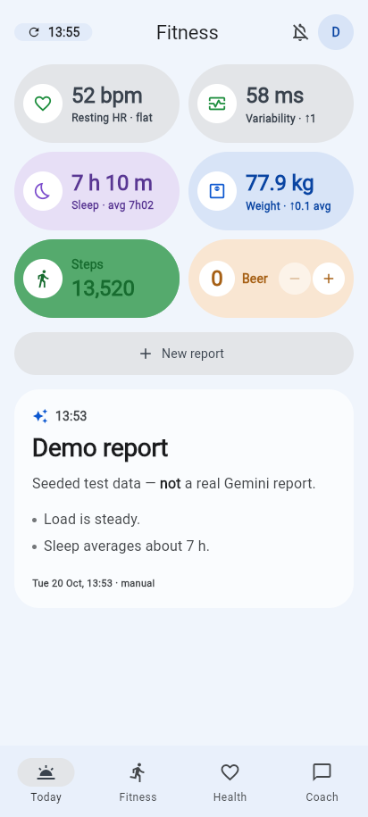
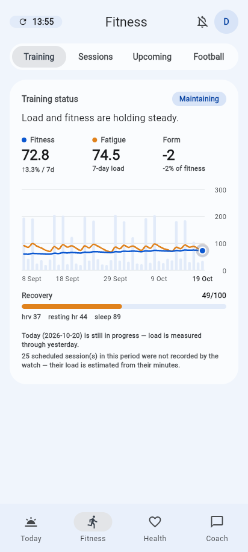
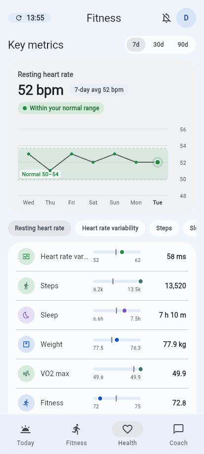

# fitness-app

A personal fitness dashboard for one amateur footballer. It pulls data from
a Fitbit/Google watch, Google Calendar and the Austrian football federation's
(ÖFB) match pages, turns it into training load, recovery and readiness, and
has Gemini write a daily report and answer questions about it. It runs on
Android and in the browser, with iOS planned, from one Flutter codebase and
a Firebase backend.

It is single-user by design: every API call needs a Google sign-in whose
email is on an allowlist. It replaces fitness-dashboard, a Next.js +
FastAPI + Postgres stack on a home server, which stays private as history
and as the reference the new numbers are checked against until the
cut-over. Both were built with Claude Code; see
[How it was developed](#how-it-was-developed).

<p>
  
  
  
</p>

<sub>Made-up demo data, taken with the repo's own
[run-app skill](.claude/skills/run-app/SKILL.md) on the emulators.</sub>

## What the app does

The app has four tabs.

| Tab | What it shows |
| --- | --- |
| **Today** | Six tiles worth a glance each day, a beer counter, the latest AI report and a **New report** button that syncs first and then asks Gemini for a fresh report. |
| **Health** | Eleven key metrics over a chosen range: resting heart rate, HRV, steps, sleep, weight, VO2 max, readiness, recovery, and the Fitness, Fatigue and Form load figures. One metric is drawn as a chart and the rest are listed under it, each showing where today falls in the range. |
| **Fitness** | Training status and the sessions behind it, the week ahead from the calendar, and **Football**: recent matches, then the league table. Opponents are rated stronger, level or weaker on points per game. |
| **Coach** | A chat with Gemini about your own data. It can see a chosen set of health history, sessions and matches, and it can pin a workout. Replies can hold charts and maths. |

Tapping a tile, a metric or a session opens a detail sheet with its chart.
Session sheets show the heart-rate trace coloured by zone.

### The numbers

- **Training load** uses Banister's impulse-response model
  ([`training_load.py`](functions/api/analysis/training_load.py)). Daily
  load is the day's Active Zone Minutes. **Fitness** is a 42-day
  exponentially weighted average of that load, **Fatigue** is a 7-day one,
  and **Form** is the difference between them. The model runs over the
  whole history every time, so the result does not depend on how much of it
  is displayed. When a scheduled training or match was not recorded by the
  watch, it counts as a flat estimate instead of a rest day.
- **Recovery** and **Readiness** are 0–100 scores. Each weighs HRV,
  resting HR and sleep against their own recent baseline, over a different
  window. They are computed in the same module.
- **Heart-rate zones** are Karvonen bands. The maximum heart rate is the
  highest one the watch has recorded and held for two readings in a row
  ([ADR-039](docs/adr/039-recorded-max-heart-rate.md)), so zones need no
  configuration.
- **Formatting** matches the old web app's en-GB output digit for digit
  ([`format.dart`](app/lib/domain/format.dart)), so the two apps can be
  compared side by side.

### What runs on its own

A single scheduled function, `jobs`, runs at :30 past every hour, Vienna
time ([`jobs.py`](functions/api/jobs.py)):

1. **Every hour** it syncs Google Health (daily metrics and exercise
   sessions), the heart-rate traces and Google Calendar.
2. **Once a night** it scrapes the ÖFB site for match results, upcoming
   fixtures and the league table
   ([ADR-040](docs/adr/040-league-table.md)).
3. **At 18:30**, if nobody pressed New report that day, it writes the
   evening report and pushes "Fitness report ready" to every registered
   device through FCM ([ADR-030](docs/adr/030-fcm-report-push.md)). If
   Gemini fails, it tries again at 19:30 and may use the fallback model
   once ([ADR-034](docs/adr/034-evening-report-last-try.md)).

## How it was developed

The app is developed with AI coding agents, mostly Claude Code: of the
first 84 commits (24 September to 14 October 2026), 49 were co-written
with it. The agent writes most of the code; I set the direction, make the
decisions and review every change. The repository is set up so that an
agent's mistakes are caught before they reach `main`:

- **[CLAUDE.md](CLAUDE.md)** is the agent's working brief: where code
  belongs, what must never be edited by hand, which checks to run, and
  the traps already found (a Firestore query that needs a composite index
  passes every emulator test and fails in production).
- **Every decision is written down** as an ADR ([docs/adr/](docs/adr/)),
  so the reasons survive between sessions and a later change can be
  checked against them.
- **Every change goes through a pull request and CI**: lint and tests for
  the functions (on the Firestore emulator) and the app, a check that the
  OpenAPI snapshot and the generated Dart client match the server, a web
  build, and an Android build when its inputs change.
- **The port is checked against the original**: `tools/migrate/`
  snapshots every endpoint of the old and the new API on the same data
  and fails on any difference ([README](tools/migrate/README.md)).
- **Cloud sessions can run the app themselves**: a session-start hook
  installs the pinned toolchain, and the
  [run-app skill](.claude/skills/run-app/SKILL.md) starts the emulators
  with made-up data and screenshots the real UI, so a change is checked
  on screen as well as in tests.

## How it is built

```
 Flutter app (Android · web · iOS later)
   │  Firebase Auth → ID token as "Authorization: Bearer …"
   ▼
 Cloud Function `api` (Python 3.13, europe-west1)
   FastAPI app behind an ASGI→WSGI adapter
   ├─ checks the token and the ALLOWED_EMAILS list
   ├─ routers → services → store (the only module that talks to Firestore)
   └─ Gemini, Google Health, Google Calendar, ÖFB
   ▼
 Firestore (eur3)       ◄── Cloud Function `jobs`, hourly via Cloud Scheduler
                             └─ FCM push to registered devices
```

- **Backend:** the FastAPI app from fitness-dashboard runs inside one HTTPS
  Cloud Function. Routers, schemas and the maths carried over. Only storage
  was rewritten, from Postgres to Firestore
  ([ADR-028](docs/adr/028-route-c-firebase.md)).
- **Data:** Firestore stores the health history and the calendar in month
  buckets. A full-history training-status call then costs about 30 reads
  instead of one per day of history, which matters on the free tier ([ADR-031](docs/adr/031-firestore-layout.md)). Clients never
  read Firestore directly; `firestore.rules` denies everything.
- **Auth:** the app signs in with Google through Firebase Auth. The API
  verifies the ID token and then checks the email against an allowlist
  ([ADR-029](docs/adr/029-firebase-auth-access-gate.md)). The Google Health
  and Calendar OAuth tokens are stored encrypted.
- **Client:** Flutter, with Riverpod for state and
  [fl_chart](https://pub.dev/packages/fl_chart) for charts. The Dart API
  client in `app/packages/fitness_api` is generated from the OpenAPI
  schema, so the client and the server cannot drift apart unnoticed
  ([ADR-032](docs/adr/032-flutter-client-state-and-api.md)).
- **Web:** built with WebAssembly (skwasm), with a plain-HTML loading screen
  and fonts loaded on first use, and served from Firebase Hosting
  ([ADR-036](docs/adr/036-web-load-performance.md),
  [ADR-038](docs/adr/038-document-isolation-policy.md)).
- **Cost:** the Blaze plan, designed to stay inside its free quotas for a
  single user, with a €1 budget alert.

## Repository layout

| Path | What |
| --- | --- |
| `app/lib/` | Flutter app (`cc.koeppl.fitness`): `api/` HTTP setup, `auth/`, `domain/` pure logic and formatting, `data/` Riverpod providers, `push/`, `ui/` tabs, sheets, charts and theme |
| `app/packages/fitness_api/` | Generated Dart API client. Do not edit it by hand |
| `app/tool/build_web.dart` | The deployed web build |
| `functions/api/` | The FastAPI app: `routers/`, `schemas/`, `services/`, `store/` (Firestore), `analysis/` (training load, heart rate, Gemini report and coach), `ingest/` and `integrations/` (Google Health, Calendar, OAuth) |
| `functions/oefb/` | ÖFB scraper and parser: matches, fixtures, league table |
| `functions/main.py` | Adapts the ASGI app and the hourly job to Cloud Functions |
| `openapi/openapi.json` | Schema snapshot that the Dart client is generated from |
| `tool/generate_api_client.sh` | Regenerates `fitness_api` (needs Java and Node) |
| `tools/migrate/` | Postgres → Firestore migration and old-vs-new API diffing ([README](tools/migrate/README.md)) |
| `firestore.rules` | Denies all client access |
| `docs/adr/` | Architecture decision records, numbered on from fitness-dashboard's (028 onwards; [index](docs/adr/README.md)) |

## Getting started

You need Flutter, the Firebase CLI, Python 3.13 and a Java runtime for the
Firestore emulator.

```bash
# Backend dependencies (Windows paths; use venv/bin on Linux/macOS)
py -3.13 -m venv functions/venv
functions/venv/Scripts/pip install -r functions/requirements-dev.txt

# Local config: copy functions/.env.example to functions/.env.local,
# add your email to ALLOWED_EMAILS, and put a GEMINI_API_KEY (a dummy is
# fine) in functions/.secret.local

# Run the backend on the emulators, then the app against them
firebase emulators:start --only auth,functions,firestore
cd app && flutter run -d chrome \
  --dart-define=API_BASE_URL=http://127.0.0.1:5001/fitness-75c22/europe-west1/api \
  --dart-define=AUTH_EMULATOR_HOST=127.0.0.1
```

To seed the emulator's Firestore, use `tools/migrate/import_firestore.py`.

### Checks

CI ([`ci.yml`](.github/workflows/ci.yml)) runs these on every pull request,
together with a web build, a check that the generated client is current,
and an Android build when its inputs change:

```bash
cd functions && venv/Scripts/python -m ruff check . && venv/Scripts/python -m pytest
cd app && flutter analyze && flutter test
```

The store tests need the Firestore emulator and are skipped without it:

```bash
firebase emulators:exec --only firestore --project demo-fitness-test "cd functions && venv/Scripts/python -m pytest"
```

### Deploying

`firebase deploy` builds the web app (`dart run tool/build_web.dart`, run as
the hosting predeploy step) and deploys hosting, functions and the Firestore
rules. Secrets (`TOKEN_ENCRYPTION_KEY`, `GOOGLE_CLIENT_ID`,
`GOOGLE_CLIENT_SECRET`, `GEMINI_API_KEY`) are kept in Secret Manager.
Non-secret settings go in `functions/.env.fitness-75c22`, which is not
committed.

## Contributing

Work on a branch and open a pull request; nothing goes to `main` directly.
The conventions are in [CLAUDE.md](CLAUDE.md): where code belongs,
regenerating the OpenAPI snapshot and the Dart client after changing a
route, single-field Firestore indexes only, and colours from the palette
rather than literals. Record significant decisions as a new ADR in
[`docs/adr/`](docs/adr/). When a decision turns out wrong, add a
superseding ADR rather than editing the old one.
